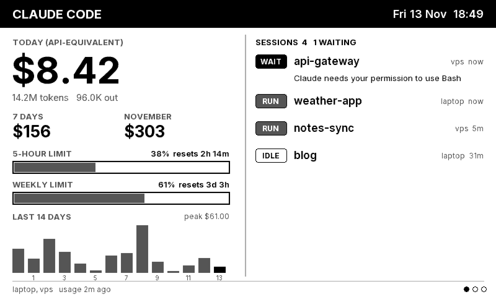
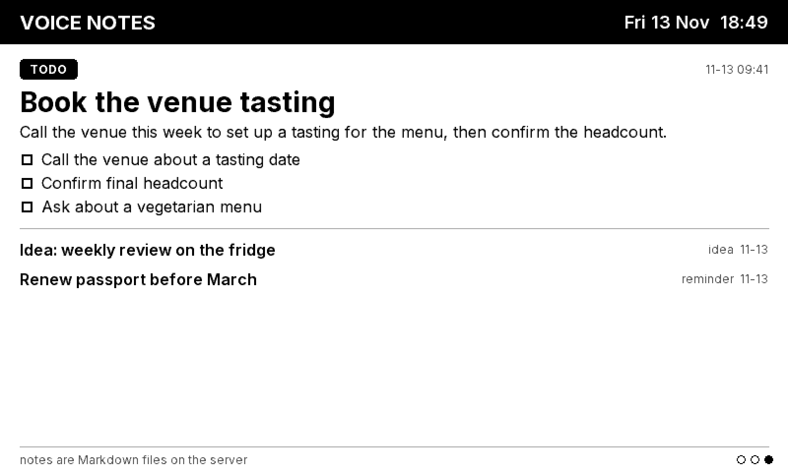
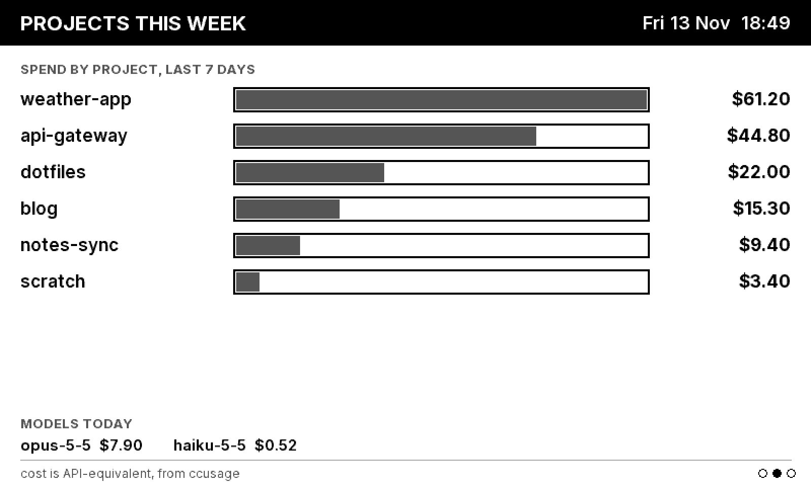

<div align="center">

<h1>Sticky</h1>

<p><b>A Claude Code dashboard and voice notepad on e-paper.</b></p>

<p><i>Your agent sessions run in terminals you can't see. A 4-inch e-paper screen on the desk shows which ones are working, which are waiting on you, and how much of your limit is left.</i></p>

<h6>


</h6>

<a href="#how-it-works"><b>How it works</b></a> ·
<a href="#features"><b>Features</b></a> ·
<a href="#run-it"><b>Run it</b></a> ·
<a href="#hardware"><b>Hardware</b></a>

<br><br>



<sub>The main page as the server renders it for the 800x480 4-gray panel. Demo data.</sub>

</div>

<br>

## The problem

Running several Claude Code sessions across a laptop and a server means one of them is usually
stuck on a permission prompt in a window you are not looking at. Usage and rate-limit numbers live
in a status line you only see in the active terminal. And a quick spoken thought has nowhere good to
go when your hands are on the keyboard.

## How it works

<table>
<tr>
<td width="33%" valign="top">

**1 · Machines report**

Claude Code hooks post session events (prompt sent, waiting for permission, stopped) and a status
line script posts the official 5-hour and weekly limits. Hooks fire in the background and never slow
Claude down.

</td>
<td width="33%" valign="top">

**2 · The server draws**

A small FastAPI server merges those events with `ccusage` cost data and renders each page as an
800x480 image snapped to the panel's four gray levels. The device only has to fetch a picture.

</td>
<td width="33%" valign="top">

**3 · The device shows and listens**

The Sticky pulls the page image over Wi-Fi. Voice recordings go the other way: whisper.cpp turns
them into text, the Claude Code CLI tidies them into a titled note, and the note is saved as
Markdown.

</td>
</tr>
</table>

&nbsp;

<sub>The voice notes and projects pages. Demo data.</sub>

## Features

- **Sessions that need you, first.** Sessions waiting on a permission prompt sort to the top in black with the prompt text; working and idle sessions follow.
- **Several machines, one board.** Every event carries its hostname, and a push script sends usage from other machines, so a laptop and a VPS show up together.
- **Official limit numbers.** The 5-hour and weekly percentages and reset times come from Claude Code's own status line input, not estimates.
- **Cost by day and by project.** `ccusage` supplies API-equivalent cost; sessions are mapped to projects from the working directory in their logs.
- **Voice to Markdown.** Upload any audio; get a note with a title, kind (todo, idea, note, reminder), summary and items. A word list helps both whisper and the cleanup step with names.
- **Nothing sensitive leaves the machine.** The hook strips tool inputs, tool output, prompts and transcript paths before posting.
- **Portable.** All settings live in `.env`; one script installs it as a launchd agent on macOS or a systemd user service on Linux.

## Run it

```bash
git clone <this repo> sticky && cd sticky
cp .env.example .env            # set STICKY_TOKEN; everything else has a default
uv sync
uv run sticky-server            # http://localhost:8787 shows a preview of every page

# keep it running across reboots (launchd on macOS, systemd on Linux)
scripts/install_service.sh

# on every machine that runs Claude Code
python3 scripts/install_client.py --url http://<server>:8787 --token <STICKY_TOKEN>
```

Voice notes need `ffmpeg`, a whisper.cpp binary (`brew install whisper-cpp` on macOS) with a model
file, and a signed-in `claude` CLI. Usage data needs Node for `npx ccusage`.

<details>
<summary><b>API</b></summary>

All endpoints except `/healthz` and `/firmware/*` need the token as `X-Sticky-Token`, `Authorization: Bearer`, or `?token=` (for the device).

| Method | Path | Purpose |
|---|---|---|
| GET | `/` | HTML preview of every page |
| GET | `/display/{page}.png` | Page image; `{page}` is `claude`, `projects`, `notes` or an index |
| GET | `/display/{page}.bmp?bits=2` | Grayscale BMP for the device: `bits=2` is native 4-level (96 KB), default 8; optional `rotate` |
| POST | `/api/hooks/claude` | Claude Code hook event JSON |
| POST | `/api/statusline` | Status line JSON with `rate_limits` |
| POST | `/api/usage/push?host=NAME` | `ccusage` data from another machine |
| GET | `/api/sessions`, `/api/usage` | The data behind the pages |
| POST | `/api/voice` | Audio (raw body or multipart `file`); returns an id |
| GET | `/api/voice/{id}` | Job status, transcript and note |
| GET | `/api/notes` | Recent notes |
| GET | `/firmware/{file}` | Files in `$STICKY_DATA_DIR/firmware` for wireless updates |

</details>

<details>
<summary><b>Wireless firmware updates</b></summary>

Build the device firmware ([sticky-firmware](https://github.com/parthchandak02/sticky-firmware), `pio run -e sticky_board`), then publish it:

```bash
uv run python scripts/publish_firmware.py ../sticky-firmware/.pio/build/sticky_board
```

The next time Board opens on the device it compares versions, offers the update, and installs it on a press of the top button.

</details>

<details>
<summary><b>Moving it to another machine</b></summary>

1. Clone the repo, copy `.env`, run `uv sync` and `scripts/install_service.sh`.
2. Copy `$STICKY_DATA_DIR` (default `~/.local/share/sticky`) if you want to keep notes and state.
3. Rerun `scripts/install_client.py` on each Claude Code machine with the new URL.
4. On machines that are not the server, add a cron entry for `uv run python -m sticky_server.push` so their usage counts too.

</details>

<details>
<summary><b>Project layout</b></summary>

```
server/sticky_server/   app.py (HTTP), state.py (sessions, limits), usage.py (ccusage),
                        voice.py (whisper + cleanup), render/ (pages and drawing)
hooks/                  sticky-hook.sh (Claude Code hook), statusline.py
scripts/                install_client.py, install_service.sh, demo_previews.py
deploy/                 launchd and systemd templates
assets/fonts/           Inter and JetBrains Mono (SIL OFL)
tests/                  pytest
```

</details>

## Hardware

| Part | Role | Link |
|---|---|---|
| Seeed reTerminal Sticky | ESP32-S3, 3.97" 800x480 4-gray touch e-paper, PDM mic, microSD | [seeedstudio.com](https://www.seeedstudio.com/reTerminal-Sticky-p-6861.html) |
| CrossMux firmware | Reader and app launcher the device firmware builds on | [0x1abin/crossmux](https://github.com/0x1abin/crossmux) |
| microSD card | Required by CrossMux; exFAT | |

The device-side app that fetches pages and records audio is not in this repo yet.

<br>

<div align="center">
<sub>Built with FastAPI, Pillow, ccusage, whisper.cpp and the Claude Code CLI.</sub>
</div>
