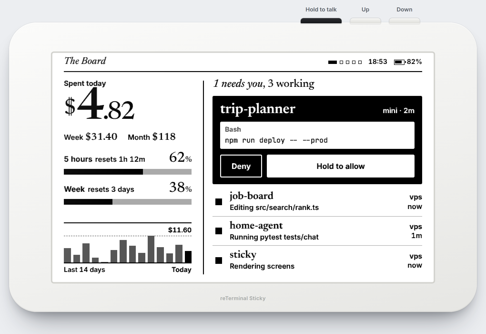
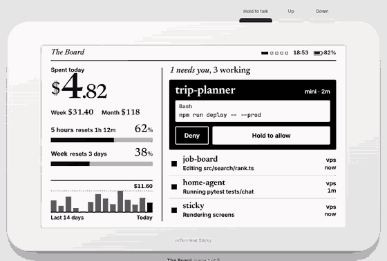
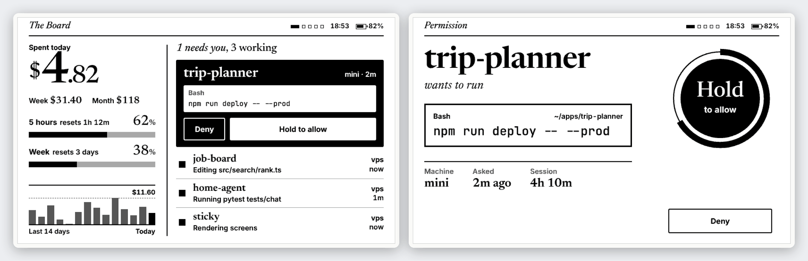
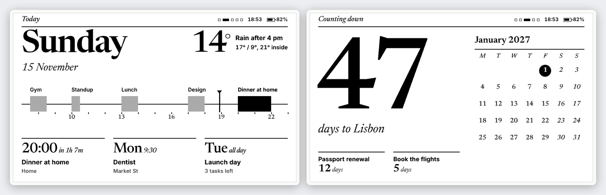
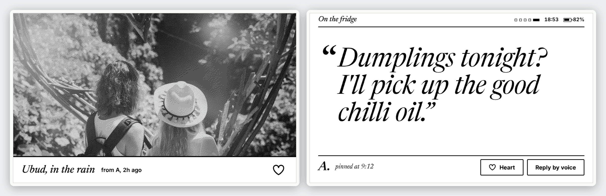
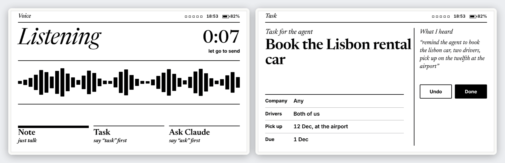
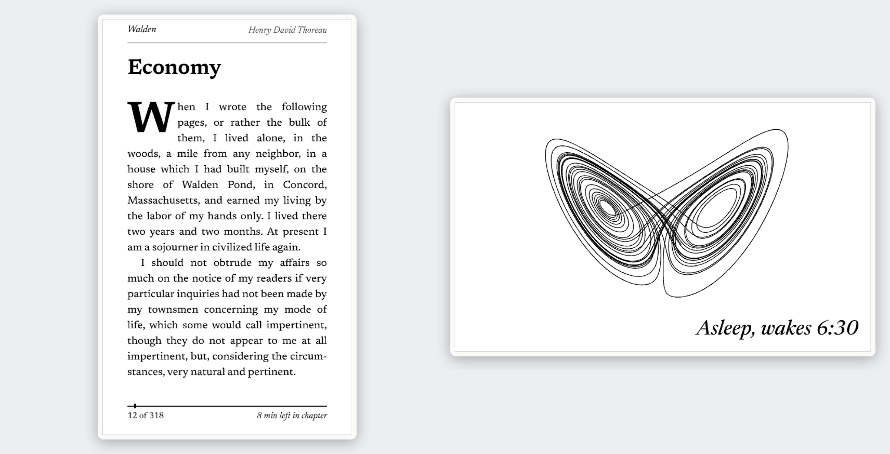

<div align="center">

<h1>Sticky</h1>

<p><b>A Claude Code dashboard and fridge note on e-paper.</b></p>

<p><i>Your agents run in terminals you can't see. A 4-inch magnetic e-paper screen shows which ones need you, lets you approve them with a press of your thumb, and on the fridge shows the photo someone just sent you.</i></p>

<h6>


</h6>

<a href="#how-it-works"><b>How it works</b></a> ·
<a href="#the-screens"><b>Screens</b></a> ·
<a href="#gestures"><b>Gestures</b></a> ·
<a href="#set-it-up"><b>Set it up</b></a>

<br><br>



<sub>The interactive prototype in <code>prototype/</code>, showing the real 800x480 four-gray frame the server sends to the device. Demo data.</sub>

</div>

<br>

## The problem

Running several Claude Code sessions across a laptop and a server means one of them is usually
stuck on a permission prompt in a window you are not looking at. Your usage limits live in a
status line you only see in the active terminal. And the screens around the house, the fridge
included, know nothing about either your work or the people you live with.

## How it works

<table>
<tr>
<td width="33%" valign="top">

**1 · Machines report**

Claude Code hooks post session events and permission prompts to a small server. A status line
script adds the official 5-hour and weekly limits. `ccusage` adds spend.

</td>
<td width="33%" valign="top">

**2 · The server draws**

Every screen is an HTML template. Headless Chromium renders it at 800x480 and snaps every pixel
to the panel's four grays, then exports where each button is, as a touch map.

</td>
<td width="33%" valign="top">

**3 · The Sticky shows and answers**

Our firmware fetches the frame and its touch map, draws it with the right e-paper refresh, and
sends back taps, holds, swipes, key presses and voice. It updates itself over Wi-Fi.

</td>
</tr>
</table>



<sub>A scripted run of the prototype with real e-ink timing: open the prompt, hold to allow, swipe through the pages. Demo data.</sub>

## The screens



<sub><b>Work.</b> The Board puts the session that needs you on top, in black, with the command it wants to run. Allowing takes a one-second hold, never a single tap.</sub>



<sub><b>Day.</b> Weather from Open-Meteo, events from any private iCal link, room temperature from the device's own sensor, and countdowns from a small JSON file.</sub>



<sub><b>Fridge.</b> Photos and notes arrive over the API, so a chat bot or a phone shortcut can put them there. Photos are tone-mapped and error-diffused to four grays.</sub>



<sub><b>Voice.</b> Hold the top key and talk. whisper.cpp transcribes on your own server, and the Claude Code CLI turns it into a titled note or task.</sub>



<sub><b>Read and sleep.</b> Turned to portrait, it is a book page (a demo for now). Asleep, it shows line art and costs no power to keep on the glass. All screens use demo data; the photo is CC0 and the book is public domain.</sub>

## Features

- **Answer Claude from across the room.** A `PermissionRequest` hook waits up to 45 seconds for a hold-to-allow or a Deny on the device, then falls back to the normal terminal prompt. It never allows anything on its own.
- **One renderer, two outputs.** The same Jinja templates make the demo frames, the prototype and the live screens, so what you design is exactly what the panel shows.
- **Built for e-paper.** Text and rules snap to four levels without blur; photos are dithered; gray screens are drawn in overlay mode so a hold ring or a tap mark can refresh in 0.3 s without a full flash.
- **Our own firmware.** About 1,700 lines (plus a generated font) on the MIT FreeInk SDK: panel, touch, keys, PDM mic, buzzer, temperature and humidity sensor, IMU and fuel gauge.
- **Updates over Wi-Fi with a safety net.** A new build boots on trial and marks itself good only after it has drawn a server frame; three failed boots switch back to the previous slot. Every image is checked against its SHA-256 and a board tag.
- **Cheap when nothing changes.** Frames carry an ETag, so an unchanged screen costs one small request and no refresh. On battery it deep-sleeps between checks; the server shortens the sleep while Claude is busy.
- **Several machines, one board.** Every event carries its hostname, and a push script sends usage from other machines.
- **Private by default.** The status hook strips prompts, tool inputs and outputs. The permission hook sends only the tool name, folder and a one-line summary, and only to your own server.

## Gestures

| Gesture | Where | What it does |
|---|---|---|
| Tap | buttons, cards, hearts | the control's action; a small mark appears at once while the next frame loads |
| Hold 1 s | Hold to allow, the allow dial | approves the Claude prompt; a ring fills under your thumb, letting go early does nothing |
| Swipe left or right | any page | next or previous page in the deck |
| Swipe up or down | photos | the next photo, or "on this day" |
| Up, Down keys | anywhere | previous or next page |
| Hold the top key | anywhere | records a voice note while held |
| Short press, top key | anywhere | back to the first page, or to the waiting prompt |

The prototype in `prototype/` behaves the same way in a browser, including the refresh flashes and
partial-refresh ghosting, so screens can be designed and tested without the device.

## Hardware

| Part | Role | Link |
|---|---|---|
| Seeed reTerminal Sticky | ESP32-S3R8, 3.97" 800x480 4-gray e-paper (SSD1677 or SSD2677), GT911 touch, PDM mic, buzzer, SHT40, LSM6DS3TR-C, BQ27220 gauge, 750 mAh | [seeedstudio.com](https://www.seeedstudio.com/reTerminal-Sticky-p-6861.html) |
| A computer that stays on | runs the server: macOS (launchd) or Linux (systemd) | |
| microSD card | optional; on first boot the firmware imports Wi-Fi saved by CrossMux from it | |

## Set it up

**1. The server**, on a machine that stays on:

```bash
git clone --recursive https://github.com/parthchandak02/sticky && cd sticky
cp .env.example .env              # set STICKY_TOKEN; everything else has a default
uv sync
uv run playwright install chromium
uv run sticky-server              # http://localhost:8787 shows a preview of every page
scripts/install_service.sh        # keep it running (launchd on macOS, systemd on Linux)
```

**2. Every machine that runs Claude Code:**

```bash
python3 scripts/install_client.py --url http://<server>:8787 --token <STICKY_TOKEN> --approve 45
```

Leave out `--approve 45` if you only want to watch, not answer prompts from the device.

**3. The firmware**, once over USB (needs [PlatformIO](https://platformio.org)):

```bash
cd firmware
printf '[local]\nbuild_flags =\n  %s\n  %s\n' \
  "'-DSTICKY_SERVER_URL=\"http://<server>:8787\"'" "'-DSTICKY_TOKEN=\"<STICKY_TOKEN>\"'" > platformio.local.ini
pio run -t upload
pio device monitor                # then: wifi add <network> <password>, status
```

After that, updates go over the air:

```bash
pio run && uv run python ../scripts/publish_firmware.py .pio/build/sticky --channel sticky-os
```

The device installs a new build on its next boot or update check (every 6 hours), or right away
when you type `ota` on the serial console. Before the first flash, back up the stock firmware
with `esptool.py read-flash`; `firmware/PLAN.md` has the exact commands.

<details>
<summary><b>Configuration</b></summary>

All settings live in `.env` (see `.env.example`).

| Setting | What it does |
|---|---|
| `STICKY_TOKEN` | Shared secret for every endpoint except `/healthz` and `/firmware/*` |
| `STICKY_DECK` | Pages to swipe through, in order (default `board,today,countdown,photo,note`) |
| `STICKY_LAT`, `STICKY_LON` | Weather on Today (Open-Meteo, no key) |
| `STICKY_CALENDAR_ICS` | A private iCal link for Today |
| `STICKY_APPROVE_WAIT` | Seconds a prompt waits for the device before the terminal asks |
| `STICKY_HOST_LABELS` | Short machine names on the Board, `host=label,...` |
| `STICKY_TZ` | Time zone for clocks and spend |

Countdowns: `$STICKY_DATA_DIR/countdowns.json`, a list of `{"name", "date", "what"}`; the first
upcoming one is the big number.

Send a note or a photo to the fridge:

```bash
curl -H "X-Sticky-Token: $TOKEN" -H 'Content-Type: application/json' \
  -d '{"text": "Dumplings tonight?", "from": "A."}' http://<server>:8787/api/fridge/note
curl -H "X-Sticky-Token: $TOKEN" -F file=@photo.jpg \
  "http://<server>:8787/api/fridge/photo?caption=Ubud&sender=A&taken=2024-11-15"
```

</details>

<details>
<summary><b>API</b></summary>

| Method | Path | Purpose |
|---|---|---|
| GET | `/screen/deck` | Pages, start page, sleep time, chime, hold length, firmware channel |
| GET | `/screen/{frame}.bmp?bits=2` | A frame for the panel (96 KB, ETag); `.png` for a preview |
| GET | `/screen/{frame}.json` | The frame's touch map: tap and hold areas in panel pixels |
| POST | `/api/action` | `{"frame", "action"}` from a tap or a finished hold; returns `{"next", "refresh"}` |
| POST | `/api/permission`, GET `/api/permission/{id}` | Used by the permission hook to wait for an answer |
| POST | `/api/fridge/note`, `/api/fridge/photo` | What the fridge shows |
| POST | `/api/hooks/claude`, `/api/statusline`, `/api/usage/push` | Claude Code events, limits, usage from other machines |
| POST | `/api/voice`, GET `/api/voice/{id}` | Audio in, note out |
| GET | `/api/sessions`, `/api/usage`, `/api/devices`, `/api/notes` | The data behind the screens; devices with battery, temperature and firmware |
| GET | `/firmware/{file}` | Builds and manifests for over-the-air updates |

Requests from the device carry `X-Sticky-Fw`, `X-Sticky-Battery`, `X-Sticky-Temp`,
`X-Sticky-Humidity`, `X-Sticky-Rssi` and `X-Sticky-Orient`.

</details>

<details>
<summary><b>Designing a screen</b></summary>

1. Add a template in `screens/templates/`, extending `_layout.html.j2`. Use the four tones in
   `base.css` (`--ink`, `--graphite`, `--pencil`, `--paper`); text stays ink or graphite.
2. Mark anything touchable with `data-tap="action"` or `data-hold="action"`. The renderer turns
   them into the touch map.
3. Add demo data to `screens/demo/data.json` and a frame to `screens/flow.json`.
4. `uv run python scripts/render_screens.py`, then open the prototype:
   `python3 -m http.server 8786` and `http://127.0.0.1:8786/prototype/`.
5. For the live server, add the frame to `FRAMES` in `server/sticky_server/app.py` and its data
   to `live.py`.
6. Refresh the README images with `uv run python scripts/readme_images.py`.

`screens/README.md` covers the refresh rules and the full gesture model.

</details>

<details>
<summary><b>Project layout</b></summary>

```
server/sticky_server/   app.py (HTTP), screens.py (renderer), live.py (live data),
                        state.py (sessions, prompts, devices), usage.py, voice.py
screens/                templates/ (HTML + CSS), demo/, flow.json, out/ (rendered frames)
prototype/              the device in a browser, driven by the rendered frames
firmware/               our firmware (PlatformIO), PLAN.md, freeink-sdk/ (submodule)
hooks/                  sticky-hook.sh, sticky-permission.py, statusline.py
scripts/                render_screens.py, proto_test.mjs, readme_images.py,
                        install_client.py, install_service.sh, publish_firmware.py
deploy/                 launchd and systemd templates
assets/fonts/           Newsreader, Inter, JetBrains Mono (SIL OFL)
cook/                   design notes and scores from the screen design rounds
tests/                  pytest
```

</details>

## Status and roadmap

An experiment that runs every day on one device. Verified on hardware: boot, panel, Wi-Fi,
frames from the server, sensors, the serial console and an over-the-air update with trial boot.
Not yet verified by hand: touch gestures, hold-to-allow, keys, voice and deep sleep on battery.
Next: the portrait reader with offline pages. See
`firmware/PLAN.md` for the phases and `CONTRIBUTING.md` to help.

<br>

<div align="center">
<sub>Built with FastAPI, Jinja, headless Chromium, ccusage, whisper.cpp, the Claude Code CLI and the <a href="https://github.com/Free-Ink/freeink-sdk">FreeInk SDK</a>. MIT licensed.</sub>
</div>
